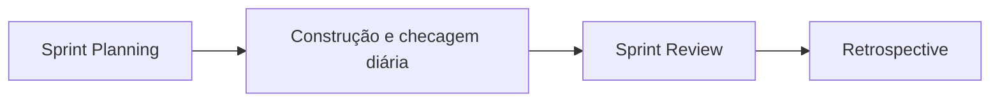
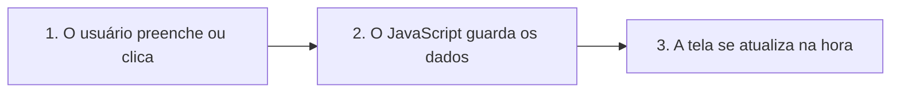

# ALE

### Seus estudos organizados em um só lugar

Organizador de entregas acadêmicas · Atividade Prática de Scrum

---

## Sumário

- [O problema](#o-problema)
- [A solução](#a-solução)
- [Demonstração](#demonstração)
- [Time Scrum](#time-scrum)
- [Objetivo do produto](#objetivo-do-produto)
- [Product Backlog](#product-backlog)
- [As 4 sprints](#as-4-sprints)
- [Funcionalidades](#funcionalidades)
- [Tecnologias](#tecnologias)
- [Armazenamento e limitações](#armazenamento-e-limitações)
- [Acessibilidade e inclusão](#acessibilidade-e-inclusão)
- [Dificuldades e melhorias futuras](#dificuldades-e-melhorias-futuras)
- [O aparelho: Assistente de voz ALE](#o-aparelho-assistente-de-voz-ale)
- [Equipe](#equipe)

---

## O problema

**Trabalhos e prazos estão espalhados, e o aluno se perde.**

| Onde estão hoje | O que isso causa |
|---|---|
| Mensagens | Esquecimentos |
| Avisos em sala | Atrasos |
| Plataformas diferentes | Dúvidas |

> "Quero uma solução simples que permita ao estudante identificar suas atividades e saber o que precisa entregar primeiro."
>
> — Coordenador da instituição (o professor)

---

## A solução

**ALE: as entregas do aluno em um só lugar.**

| | Site | Para quem |
|:---:|---|---|
| **Site 1** | **[ALE Aprender](https://ale-aprender.netlify.app)** | Ensino Fundamental: um layout lúdico até o 6º ano e outro objetivo do 7º ao 9º, com áreas para aluno e professor. |
| **Site 2** | **[ALE](https://ale0.netlify.app)** | Organização acadêmica: calendário, radar de prazos, planejamento de estudos e acompanhamento de entregas. |

> **Diferencial:** acessibilidade com VLibras, alto contraste e leitor de voz.

---

## Demonstração

Os dois sites estão publicados no Netlify. Aponte a câmera do celular para o QR code ou clique nos links.

  

- **Site 1 – [ALE Aprender](https://ale-aprender.netlify.app):** o professor cadastra um trabalho e o aluno do 8º ano envia a resposta.
- **Site 2 – [ALE](https://ale0.netlify.app):** calendário, radar de prazos, planejamento e entregas.

### Fluxo da demonstração

  

<b>Fluxo em texto</b>

 

**Site 1 · ALE Aprender**

1. Abrir o site
2. Boas-vindas: escolher o perfil (com barra de acessibilidade, leitor de voz e VLibras)
3. Professor ou estudante?
   - **Professor:** Cadastrar um trabalho → Escolher os anos finais → Voltar e entrar como aluno
   - **Estudante:** Entrar no 8º ano → Ver Atividades e Provas → Abrir e enviar a resposta

**Site 2 · ALE**

Entrar na conta → Calendário → Radar de prazos → Planejamento de estudos → Acompanhar as entregas

---

## Time Scrum

**Quem faz o quê no time**

| Papel | Quem | Responsabilidade |
|---|---|---|
| **Product Owner** | Henrique Novais | Ordena o backlog e decide as prioridades. |
| **Scrum Master** | Mateus Alves | Cuida dos tempos e remove impedimentos. |
| **Developers** | 7 integrantes | Planejam, constroem e testam o protótipo. |
| **Stakeholder** | O professor | Representa o coordenador e dá feedback na Review. |

> **PO:** o quê e por quê · **Developers:** como construir · **Scrum Master:** como trabalhar melhor

---

## Objetivo do produto

> **Ver todas as atividades em um só lugar e descobrir, em segundos, qual é a próxima entrega.**

**Como o ALE mostra cada pendência:**

| | Situação | Regra |
|:---:|---|---|
| 🔴 | **Atrasada** | A data de entrega já passou |
| 🟡 | **Entrega hoje** | A data de entrega é hoje |
| 🔵 | **Próxima do vencimento** | Faltam de 1 a 3 dias |
| 🟢 | **Dentro do prazo** | Faltam mais de 3 dias |

A situação aparece escrita, não só pela cor. Os prazos contam apenas a data, sem horário.

---

## Product Backlog

**8 itens, ordenados pelo valor para o aluno.**

| ID | Item | Requisito |
|:---:|---|:---:|
| **PB1** | Cadastrar atividade com prazo | RF01 |
| **PB2** | Ver pendências na tela inicial | RF02 |
| **PB3** | Ordenar pendências por prazo | RF03 |
| **PB4** | Mostrar a situação do prazo | RF04 |
| **PB5** | Marcar como concluída | RF08 |
| **PB6** | Ver detalhes da atividade | RF05 |
| **PB7** | Filtrar e pesquisar | RF09 · RF10 |
| **PB8** | Editar e excluir | RF06 · RF07 |

> **PB1–PB5:** o fluxo que o professor vai pedir na Review: cadastrar, achar a próxima entrega e concluir.

---

## As 4 sprints

**O MVP fica pronto no fim da Sprint 3.**

| Sprint | Meta | Descrição | Itens |
|---|---|---|:---:|
| **Sprint 1** | Cadastrar e ver pendências | Cadastrar uma atividade e ver as pendências. | PB1 · PB2 |
| **Sprint 2** | Saber o que entregar primeiro | Ver as pendências por prazo e achar a próxima. | PB3 · PB4 |
| **Sprint 3** ⭐ MVP | Concluir e consultar | Concluir uma atividade sem perdê-la e ver os detalhes. | PB5 · PB6 |
| **Sprint 4** | Organizar e apresentar | Filtro, busca, edição e a Review com o professor. | PB7 · PB8 |

**Em toda sprint:**

---

## Funcionalidades

**Dois sites, dois layouts.**

### [ALE Aprender](https://ale-aprender.netlify.app)

| Perfil | O que tem |
|---|---|
| **Até o 6º ano** · layout lúdico | Jogos, atividades da turma, leitura com narração e estrelas |
| **7º ao 9º ano** · layout objetivo | Próximas entregas e provas, XP, média e disciplinas |
| **Professor** | Cria turmas com código e cadastra atividades, provas e jogos |

### [ALE](https://ale0.netlify.app)

Organização acadêmica, com outro layout:

- Entrar na conta
- Calendário
- Radar de prazos
- Planejamento de estudos
- Acompanhamento de entregas

---

## Tecnologias

**Feito com HTML, CSS e JavaScript.**

| Linguagem | Papel | O que faz |
|---|---|---|
| **HTML** | Estrutura | As telas: boas-vindas, perfis, painéis, formulários e janelas. |
| **CSS** | Visual | Cores, temas claro e escuro, alto contraste e os layouts de cada idade. |
| **JavaScript** | Funcionamento | Navegação, cadastros, jogos, prazos e leitor de voz. |

- **Recursos:** Web Speech API (leitor de voz), VLibras (Libras) e Google Fonts.
- **Publicação:** os dois sites no Netlify; o ALE troca de tela por rotas, como `#/entrar`.

---

## Armazenamento e limitações

**Os dados ficam no próprio navegador.**

| Site | Como guarda os dados |
|---|---|
| **ALE Aprender** | Turmas e atividades ficam na memória da página, com dados de exemplo. Ao recarregar, tudo volta ao início. |
| **ALE** | Salva as informações no armazenamento local do navegador, que continuam lá ao reabrir o site. |

> [!WARNING]
> **Limitações:** sem servidor nem banco de dados · não sincroniza entre aparelhos · limpar o navegador apaga tudo · sem cópia de segurança.

---

## Acessibilidade e inclusão

**Feito para todos os alunos usarem.**

| Recurso | Descrição |
|---|---|
| **Tema claro e escuro** | O fundo mais confortável para cada um. |
| **Alto contraste** | Mais legível para quem tem baixa visão. |
| **Tamanho do texto** | Botões A+, A− e A para ajustar a letra. |
| **Leitor de voz** | Lê os textos em voz alta ao passar o mouse. |
| **VLibras** | Traduz o conteúdo para Libras. |
| **Layout por idade** | Lúdico até o 6º ano e objetivo do 7º ao 9º. |

Em todas as telas, a barra de acessibilidade fica no topo do ALE Aprender.

---

## Dificuldades e melhorias futuras

### Dificuldades

- Guardar os dados sem servidor nem banco de dados
- Criar dois layouts para idades diferentes
- Leitor de voz e VLibras em todas as telas
- Manter dois sites com funções diferentes

### Melhorias futuras

| | Ideia | Descrição |
|:---:|---|---|
| **01** | **App do ALE** | Transformar o site em aplicativo. |
| **02** | **ALE Ao Vivo** | O professor faz videoaula com a turma. |
| **03** | **ALEWatch** | Relógio acessível e econômico, de materiais recicláveis. |
| **04** | **ALE Offline** | Boa parte das funções mesmo sem internet. |

  
   
  ALEWatch

---

## O aparelho: Assistente de voz ALE

O organizador na mesa de estudos, sem precisar pegar o celular.

  

- 🗣️ Fala o resumo do dia
- 💡 Anel de luz avisa as entregas perto de vencer
- ⏱️ Pomodoro com luzes de foco e pausa
- ❓ Simulados e dúvidas por voz

> **ALE Eco:** plástico reciclado, tecido de fibras recicladas e base de madeira reaproveitada.

---

## Equipe

| Integrante | Papel |
|---|---|
| Henrique Novais de Oliveira | Product Owner |
| Mateus Alves dos Santos | Scrum Master |
| Wendel Andrioli de Melo | Developer |
| Luiz Felipe | Developer |
| Nathan Vieira | Developer |
| Washington de Souza Silva | Developer |
| Mateus Moreira | Developer |
| Diego Pignatari | Developer |
| Kauã Justino da Silva | Developer |

---

**ALE** · Organizador de entregas acadêmicas

**Perguntas?**
